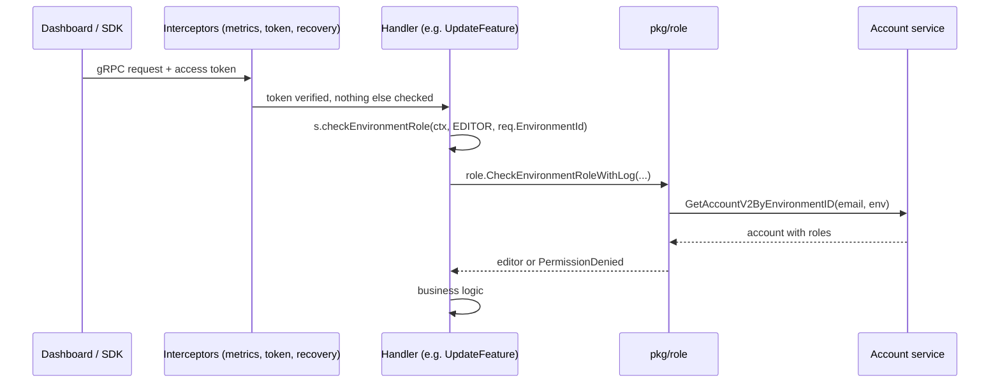
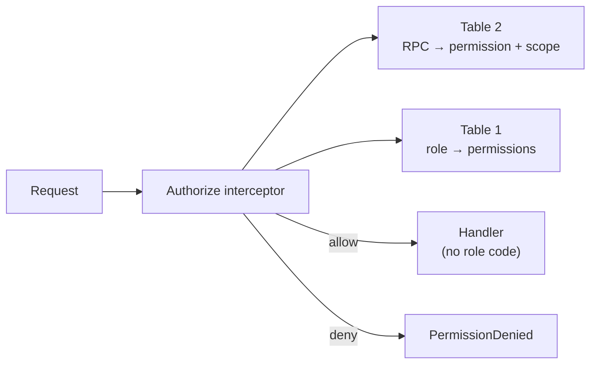

# Centralized Authorization: Rules as Data, One Interceptor

- Status: Draft
- Authors: Naoyuki Sekine, Hien Vu
- Related: #2856 (multiple owners), #2995 (scope every SQL query), PR #2950 (owner demotion fix)

## Summary

Today every gRPC handler decides for itself who may call it. The same check is
copied into about 150 handlers across 15 packages, and a rule that is missing
in one handler is a security bug that nobody can see without grep.

This RFC moves the rules out of the handlers into two small tables (Go data)
and checks them in one gRPC interceptor that runs before every handler. The
roles users see (Organization Owner / Admin / Member, Environment Editor /
Viewer) do not change. What changes is where the rules live and how many
places have to be right.

## 1. Background

### 1.1 Words used in this document

- **RPC**: one API method defined in a `.proto` file, such as
  `FeatureService.UpdateFeature`. Every request from the dashboard, the SDKs
  or the public API ends up in exactly one RPC handler.
- **Handler**: the Go function that implements one RPC
  (`func (s *FeatureService) UpdateFeature(ctx, req)`).
- **Interceptor**: a function the gRPC server runs before every handler.
  `pkg/rpc/server.go` already chains three of them (metrics, token
  verification, panic recovery). The handler never sees a request the
  interceptor rejected.
- **Role**: what an account is in an organization (`OWNER`, `ADMIN`, `MEMBER`)
  and, for a member, in each environment (`EDITOR`, `VIEWER`, `UNASSIGNED`).
  These are defined in `proto/account/account.proto` and are not changed here.
- **Scope**: the organization or environment a request is about. The role
  check only makes sense for that scope.

### 1.2 How a request is authorized today



Three layers take part, and the rule itself ("UpdateFeature needs EDITOR") is
written in the handler:

1. `pkg/role/role.go` (449 lines) holds the shared logic: how to read the
   token, the special cases for system admins (read anything, write only as an
   organization member), service tokens (internal jobs, full access) and
   requests relayed by the public API gateway (checked as the API key's
   maintainer).
2. Each of the 15 `pkg/<domain>/api` packages has its own private copy of a
   wrapper (`checkEnvironmentRole`, `checkOrganizationRole`,
   `checkSystemAdminRole`; 31 functions in total) that fetches the account and
   calls `pkg/role`. Each handler calls the wrapper with the role it needs:

   ```go
   func (s *FeatureService) UpdateFeature(ctx context.Context, req *UpdateFeatureRequest) (...) {
       editor, err := s.checkEnvironmentRole(ctx, accountproto.AccountV2_Role_Environment_EDITOR, req.EnvironmentId)
       if err != nil {
           return nil, err
       }
       // business logic
   }
   ```

   About 150 handlers follow this pattern.
3. The public API gateway (`pkg/api/api`, 85 RPCs) has a separate system. Each
   handler lists the API key roles it accepts
   (`checkRequest(ctx, []APIKey_Role{PUBLIC_API_WRITE, PUBLIC_API_ADMIN})`),
   then relays the call to the web service with a service token, where layer 2
   checks the key's maintainer again.

### 1.3 Rules that depend on the target

Some rules are not "may the caller call this RPC" but "may the caller do this
to that account". Those live as ad-hoc `if` blocks inside the handler. The
current `UpdateAccountV2` runs, in order: an ADMIN check; if that fails, a
MEMBER check plus "is it my own account" plus "am I trying to change my own
privileges"; if the ADMIN check passed, "is the target's role within my
authority" (twice), "is the target the organization owner" (only when
disabling or changing the role) and "are the environment roles inside this
organization". Nothing ties these blocks together, so `DisableAccountV2`,
`DeleteAccountV2` and `UpdateOrganization` each have their own subset.

### 1.4 Why this is a problem

- **There is no place to read "what may an Admin do".** The matrix exists
  only as the union of 150 call sites. Reviewers, the dashboard and AI tools
  all have to reconstruct it, and they get it wrong.
- **A missing check is invisible.** PR #2950 fixed an owner who could demote
  themselves: the owner guard was in disable and delete, but not in role
  change. #2995 found list queries that returned every organization when the
  scope ID was empty, because the handler relied on the caller to pass it.
- **Every new rule touches many handlers.** Ownership transfer and multiple
  owners (#2856) mean editing the account handlers again and hoping none is
  missed.
- **The dashboard duplicates the rules.** The UI recomputes `hasEditable` /
  `isOrganizationAdmin` on its own, and `GetMe` fakes an `EDITOR` role on
  every environment for system admins so the UI works
  (`getAdminConsoleAccountEnvironmentRoles`).
- **The same helper is copied.** "A member sees only the environments they
  belong to" (`getAllowedEnvironments`) is implemented four times
  (subscription, push, account, tag).

## 2. Goals / Non-Goals

Goals

- One file answers "which RPC needs which permission in which scope".
- One file answers "which role grants which permissions".
- One interceptor applies both. A handler contains no role code.
- Target-dependent rules (owner protection, no privilege escalation,
  self-service edits) are implemented once and attached by name.
- The existing special cases (system admin, service token, public API key
  maintainer) keep their exact behavior.
- A table-driven test covers every RPC × every role.

Non-Goals

- Changing the roles users see, the `account_v2` schema or the dashboard
  screens.
- Replacing the data filters inside list queries ("show only my
  environments"). The interceptor answers allow / deny; filtering rows is
  still the handler's job, through one shared helper.
- Adopting an external authorization service (see Alternatives).

## 3. Design Overview



1. **Table 1: what each role may do.** A role is a list of permissions
   (`feature:write`, `account:manage`, ...).
2. **Table 2: what each RPC needs.** One row per RPC: the permission, where in
   the request the scope ID is, and optional guards.
3. **One interceptor** in `pkg/rpc` reads the RPC name from `info.FullMethod`,
   looks up Table 2, resolves the scope, loads the caller's roles once,
   checks Table 1 and the guards, and puts the resulting editor into the
   context. The handler reads it with `rpc.EditorFrom(ctx)`.

Before and after, for `UpdateFeature`:

```go
// Today: the rule is in the handler.
editor, err := s.checkEnvironmentRole(ctx, EDITOR, req.EnvironmentId)
if err != nil {
    return nil, err
}

// Proposed: the rule is in Table 2; the handler trusts the interceptor.
editor := rpc.EditorFrom(ctx)
```

## 4. Design Details

### 4.1 Table 1: role → permissions

```go
// pkg/authz/permissions.go
var rolePermissions = map[Role][]Permission{
    OrgOwner:  {"*"},
    OrgAdmin:  {"organization:read", "account:manage", "apikey:manage", "env:*"},
    OrgMember: {"organization:read"},            // plus the environment roles below
    EnvEditor: {"feature:read", "feature:write", "segment:read", "segment:write", "experiment:read", "experiment:write", /* ... */},
    EnvViewer: {"feature:read", "segment:read", "experiment:read", /* ... */},
}
```

Permission names follow `<resource>:<verb>`. The first draft is produced
mechanically from the current `checkXRole` calls: every `VIEWER` call becomes
`<resource>:read`, every `EDITOR` call `<resource>:write`, every `ADMIN` call
`<resource>:manage`.

### 4.2 Table 2: RPC → requirement

```go
// pkg/authz/methods.go
var methodRequirements = map[string]Requirement{
    "/bucketeer.feature.FeatureService/GetFeature":        Need("feature:read",  InEnv("environment_id")),
    "/bucketeer.feature.FeatureService/UpdateFeature":     Need("feature:write", InEnv("environment_id")),
    "/bucketeer.account.AccountService/UpdateAccountV2":   Need("account:manage", InOrg("organization_id")).
        Or(Self("email"), NoPrivilegeChange()).
        Guard(RoleNotAboveCaller("organization_role")).
        Guard(NotLastOwner("email")),
    "/bucketeer.auditlog.AuditLogService/ListAuditLogs":   EachScope(Env("environment_id", "auditlog:read"), Org("organization_id", "auditlog:manage")),
    "/bucketeer.environment.EnvironmentService/UpdateEnvironmentV2": Need("environment:manage", OrgOfEnvironment("id")),
    "/bucketeer.notification.NotificationService/CreateAdminNotification": SystemAdminOnly(),
    "/bucketeer.auth.AuthService/SignIn":                 Public(),
}
```

Scope resolvers, chosen from what the request carries (counted from the
`.proto` files of the 18 web services, 263 RPCs in total):

| Resolver | Used when | Example |
| --- | --- | --- |
| `InEnv(field)` | the request has `environment_id` | most feature / experiment / autoops RPCs |
| `InOrg(field)` | the request has `organization_id` | account, team, organization-wide lists |
| `InEnvOrOrg(envField, orgField)` | lists that accept either ID and return one scope's rows | `ListTags` (#2995) |
| `EachScope(Env(...), Org(...))` | lists that accept both IDs and return both scopes' rows; every supplied ID is checked at its own threshold, never one instead of the other | `ListAuditLogs`: environment VIEWER for the environment's logs and organization ADMIN for the organization-level logs, as `checkScopeRole` does today |
| `OrgOfEnvironment(idField)` / `OrgOfProject(idField)` | the request has only the resource `id` | 19 environment-service RPCs such as `UpdateEnvironmentV2`, `EnableProject` |
| `SystemAdminOnly()` | no scope; system admins only | admin notifications, admin subscriptions, `ListOrganizations` |
| `Public()` | no token yet | `SignIn`, `ExchangeToken`, `FlagTriggerWebhook` (token in body) |

A RPC with no row in Table 2 is **denied** and fails the table-driven test, so
a new RPC cannot be shipped without a rule.

### 4.3 The interceptor

```go
// pkg/rpc/authz.go
func AuthorizeUnaryServerInterceptor(authz *authz.Authorizer) grpc.UnaryServerInterceptor {
    return func(ctx context.Context, req interface{}, info *grpc.UnaryServerInfo, handler grpc.UnaryHandler) (interface{}, error) {
        requirement, ok := authz.Requirement(info.FullMethod)
        if !ok {
            return nil, status.Error(codes.PermissionDenied, "no authorization rule")
        }
        editor, err := authz.Check(ctx, requirement, req.(proto.Message)) // Table 2 → scope → roles → Table 1 → guards
        if err != nil {
            return nil, err
        }
        return handler(rpc.WithEditor(ctx, editor), req)
    }
}
```

It is added to the chain in `pkg/rpc/server.go` after the token interceptor.
A stream interceptor with the same logic covers the one streaming RPC
(`AIChatService.Chat`).

One handler is outside gRPC: the dashboard's `/v1/aichat/chat` is an HTTP SSE
handler registered on the REST server (`rest.WithService(chatHTTPSvc)` in
`pkg/web/cmd/server/server.go`), so no interceptor sees it. It calls
`authz.Check` explicitly with its own method name and a row in Table 2, and the
table-driven test lists it next to the gRPC RPCs. It is the only such handler
today.

`authz.Check` keeps the special cases that `pkg/role/role.go` implements today,
moved as they are:

| Caller | Today | Proposed |
| --- | --- | --- |
| Service token (`IsSystemAdmin && IsServiceToken`) | full access | full access |
| Service token relayed by the public API gateway (API key metadata present) | checked as the key's maintainer | checked as the key's maintainer |
| System admin, read permission | allowed without membership | allowed without membership |
| System admin, write permission | must be an organization member with the role | must be an organization member with the role |
| Disabled account | Unauthenticated | Unauthenticated |

### 4.4 Guards

A guard is a named function `(caller, request, target) -> error` implemented
once in `pkg/authz/guards.go` and attached in Table 2:

- `RoleNotAboveCaller(field)`: neither the target's current organization
  role nor the role being granted is above the caller's own, so an ADMIN can
  neither demote an OWNER nor create one. A public API key editor can never
  grant or act on OWNER, and system admins are exempt from the hierarchy
  (replaces `checkOrganizationRoleWithinEditorAuthority` and
  `canManageOrganizationRole`, with both checks and both exceptions).
- `NotLastOwner(field)`: runs only when the request removes active ownership
  (disable, delete, or an organization role change away from OWNER). Profile
  updates and an unchanged OWNER role pass untouched, as today. It rejects when
  the target is the last active OWNER of the organization (replaces
  `checkNotOrganizationOwner`, attached to `UpdateAccountV2`,
  `DisableAccountV2`, `DeleteAccountV2`, `UpdateOrganization`).
- `Self(field)` + `NoPrivilegeChange()`: a member may update their own account
  as long as `organization_role`, `environment_roles` and `disabled` are
  absent or equal to the stored values. A client that echoes its unchanged
  environment roles, as the dashboard profile form does, keeps working
  (replaces the self-service branch and `selfServicePrivilegeChangeAttempted`;
  a field whitelist was rejected because it would break that client).
- `EnvironmentsInOrganization(field)`: the environment roles being set belong
  to the request's organization (replaces
  `checkEnvironmentRolesInOrganization`).

Forgetting a guard becomes a one-line omission in Table 2 that the
table-driven test catches, instead of a missing `if` in one of four handlers.

With `NotLastOwner`, "owner" means "has the OWNER role". The
`organization.owner_email` column is no longer needed for protection, which is
what #2856 (multiple owners) and ownership transfer need: transfer is "grant
OWNER to B, remove from A" in one transaction.

Guards run before the handler, so two concurrent requests that each remove a
different owner could both pass and leave the organization without one. The
guard is therefore only a fast pre-check: every owner-removing mutation also
locks the organization row (`SELECT ... FOR UPDATE`) and re-checks inside the
same transaction that at least one active OWNER remains, and a transfer is
evaluated against the resulting owner set.

Today `checkOrganizationOwner` (`pkg/environment/api/organization.go`) also
lets the `owner_email` account act as owner even when its role was demoted
below OWNER, as a recovery path covered by a regression test. Role-only
ownership removes that path, so before it is enforced every organization's
`owner_email` account must be audited and given the OWNER role where it is
missing (§5 step 3). Otherwise a legacy organization could end up with no
recognized owner, and its former owner would become deletable.

### 4.5 Public API gateway

The gateway (`pkg/api/api`) keeps authenticating the API key, but the
accepted key roles move from the 85 `checkRequest(ctx, []APIKey_Role{...})`
calls into a third column of Table 2:

```go
"/bucketeer.gateway.Gateway/UpdateFeature": Need("feature:write", FromAPIKey()).APIKey(PUBLIC_API_WRITE, PUBLIC_API_ADMIN),
```

Gateway rows use the `FromAPIKey()` resolver: the scope is the environment of
the authenticated API key, not a request field. The gateway already forwards
`envAPIKey.Environment.Id` rather than anything from the request
(`pkg/api/api/feature.go`), and SDK requests carry no `environment_id`, so
reading a request field would reject valid calls or check a scope other than
the one relayed. Authorization and the relay use the same scope.

The relay to the web service is unchanged: the web interceptor still checks
the key's maintainer, so a key never grants more than its maintainer has.

### 4.6 Dashboard

`GetMe` returns the caller's roles as today plus the list of permissions they
hold per environment, computed from Table 1. The UI calls
`can("feature:write", environmentId)` instead of `hasEditable` /
`isOrganizationAdmin`. The fake EDITOR roles for system admins are removed.
Screens do not change.

### 4.7 What stays in handlers

- **Row filters.** "A member sees only their environments" is a `WHERE`
  condition, not an allow / deny. The four `getAllowedEnvironments` copies
  become one helper `authz.AccessibleEnvironmentIDs(editor)` (already in
  `pkg/role`), called from the handler.
- **Scope IDs in SQL.** #2995 makes every query take `environment_id` /
  `organization_id`. The interceptor guarantees the ID is present and
  authorized; the storage layer still has to use it.

### 4.8 Testing

- `pkg/authz` gets one table-driven test: every RPC in Table 2 × every role
  (plus system admin, service token, disabled) → expected allow / deny.
- A test fails when a RPC in any `service.proto` has no row in Table 2.
- Existing handler tests drop their `checkXRole` mocks and instead put an
  editor into the context.

## 5. Rollout plan

1. **Shadow mode.** Add `pkg/authz` (tables, guards, interceptor), filled in
   mechanically from today's `checkXRole` calls. The interceptor logs every
   disagreement with the handler's own check and denies nothing. Run on dev
   and production until the log is clean.
2. **Enforce per service.** Starting with small services (tag, team, coderef),
   turn the interceptor on for that service's RPCs and delete its wrapper and
   handler checks. Repeat for each package. The AI chat HTTP handler switches
   to the explicit `authz.Check` call in the same step as `aichat`.
3. **Account service last.** First audit every organization's `owner_email`
   account and grant it the OWNER role where missing, so no organization is
   left without a recognized owner. Then replace the ad-hoc `if` blocks with
   the guards, add the in-transaction owner check, and stop reading
   `owner_email` for protection.
4. **Public API gateway.** Move the API key role lists into Table 2.
5. **Dashboard.** Read the permission list from `GetMe`; remove the fake
   EDITOR roles.
6. Delete `pkg/role/role.go` once nothing calls it.

Each step is its own PR and can be reverted independently.

## 6. Alternatives considered

### 6.1 Keep handler checks, add a linter

A custom `go vet` rule could flag handlers without a `checkXRole` call. It
catches the missing call but not the wrong role, the wrong scope field or a
missing guard, and the matrix still lives in 150 places.

### 6.2 Casbin

A Go policy library that would hold the same tables. It models one flat tenant;
organization → environment scoping and target-dependent guards would have to
be written around it, which is the part this RFC centralizes.

### 6.3 OpenFGA / SpiceDB

A separate authorization service with relationship tuples. It removes
hand-written rules entirely but adds a service and a second database that
must stay in sync with `account_v2`. Worth revisiting only if resources are
ever shared across organizations.

### 6.4 What other projects do

| Project | Rules are written as | Checked by |
| --- | --- | --- |
| Grafana | a role = list of actions (`dashboards:write`) | one middleware on every route |
| Kubernetes | a role = verbs on resources; a binding = user + role + scope | one authorizer |
| Unleash | a role = list of permission names (`UPDATE_FEATURE`) | one middleware |
| LaunchDarkly | JSON allow / deny policies | one evaluator |

The proposal follows the same shape: rules as data, one check point.

## 7. Open questions

1. Permission granularity: one `feature:write` for every feature mutation, or
   finer verbs (`feature:archive`, `feature:clone`)? The first draft uses the
   coarse form and can be split later without touching handlers.
2. Should the public API gateway be in the first shadow-mode run, or after the
   web services are enforced?
3. The dev cluster still has environments with an empty `environment_id`
   (#2995). Enforcement for scope resolvers must wait until they are removed.
