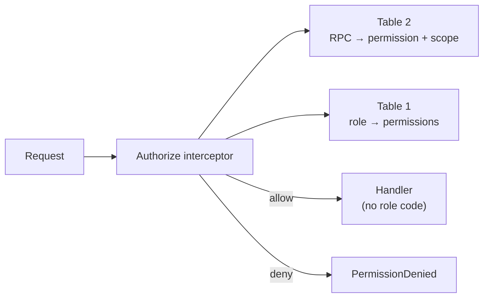

# Centralized Authorization

This RFC moves the authorization rules out of the gRPC handlers into two
tables checked by one interceptor.

**Issue**: #3006

- Status: Draft
- Authors: Naoyuki Sekine, Hien Vu
- Related: #2856 (multiple owners), #2995 (scope every SQL query), PR #2950 (owner demotion fix)

## 1. Background

Today every handler decides for itself who may call it. About 150 handlers
across 15 packages call their own `checkXRole` wrapper, `pkg/role/role.go`
is a nest of `if … else` for the special cases (system admin, service token,
public API key), and target-dependent rules such as owner protection live as
ad-hoc `if` blocks inside the account handlers. The dashboard re-implements the
same rules, and `GetMe` synthesizes environment roles for system admins
(VIEWER on every environment for non-members, EDITOR for organization admins)
so the UI works.

A missing check is invisible without grep: PR #2950 fixed an owner demotion
that one handler did not guard, and #2995 found list queries that returned
every organization when the scope ID was empty. Every new rule, such as
ownership transfer (#2856), means editing many handlers again.

## 2. Goals / Non-Goals

Goals

- One file answers "which RPC needs which permission in which scope".
- One file answers "which role grants which permissions".
- One interceptor applies both. A handler contains no role code.
- Target-dependent rules (owner protection, no privilege escalation,
  self-service edits, account visibility) are implemented once and attached by name.
- The existing special cases keep their exact behavior.
- A test covers every RPC × every role, so a missing rule fails the build.

Non-Goals

- Changing the roles users see, the `account_v2` schema or the dashboard screens.
- Replacing the row filters inside list queries ("show only my environments").
  The interceptor answers allow / deny; filtering rows stays in the handler
  through one shared helper.
- Adopting an external authorization service.

## 3. Design Overview



1. **Table 1: what each role may do.** A role is a list of permissions
   (`feature:write`, `account:manage`, ...).
2. **Table 2: what each RPC needs.** One row per RPC: the permission, where in
   the request the scope ID is, and optional guards.
3. **One interceptor** in `pkg/rpc` looks up the RPC in Table 2, resolves the
   scope, loads the caller's roles once, checks Table 1 and the guards, and
   puts the resulting editor into the context.

Before and after, for `UpdateFeature`:

```go
// Today: the rule is in the handler.
editor, err := s.checkEnvironmentRole(ctx, EDITOR, req.EnvironmentId)
if err != nil {
    return nil, err
}

// Proposed: the rule is in Table 2; the handler trusts the interceptor.
editor := rpc.EditorFrom(ctx)
```

## 4. Design Details

### Table 1: role → permissions

A Go map from role to permission names in the form `<resource>:<verb>`
(`feature:read`, `feature:write`, `account:manage`, ...). Organization OWNER
holds everything; ADMIN inherits every environment permission without an
environment role, as `pkg/role` behaves today. The first version is derived
mechanically from the current `checkXRole` calls (VIEWER → `read`, EDITOR →
`write`, ADMIN → `manage`).

### Table 2: RPC → requirement

A Go map from the full RPC name to its requirement, written like this:

```go
"/bucketeer.feature.FeatureService/UpdateFeature":   Need("feature:write", InEnv("environment_id")),
"/bucketeer.account.AccountService/UpdateAccountV2": Need("account:manage", InOrg("organization_id")).
    Or(Self("email"), NoPrivilegeChange()).
    Guard(RoleNotAboveCaller("organization_role")).
    Guard(NotLastOwner("email")),
```

The scope resolver says where the scope comes from: an `environment_id` or
`organization_id` in the request, the organization of a resource whose `id`
is the only field (environment service), the authenticated API key (gateway),
both IDs each checked at its own threshold (audit logs), system admin only, or
public. An RPC with no row is denied.

### Interceptor

Added to the chain in `pkg/rpc/server.go` after token verification, with a
stream variant for `AIChatService.Chat`. Handlers outside gRPC (the AI chat
SSE endpoint and the gateway's native SDK routes) call the same authorizer
explicitly. The special cases move as they are: service tokens have full
access, requests relayed by the public API gateway are judged as the API key's
maintainer, system admins read without membership but write only as a member,
disabled accounts get Unauthenticated.

### Guards

A guard is a named function checked after the permission, implemented once
and attached in Table 2:

- `RoleNotAboveCaller`: neither the target's current role nor the granted role is above the caller's; API keys never touch OWNER; system admins are exempt.
- `NotLastOwner`: an owner-removing change (disable, delete, demote) is rejected when the target is the last active OWNER; the storage transaction re-checks it under a row lock.
- `Self` + `NoPrivilegeChange`: a member may update their own profile as long as the privilege fields are unchanged, and those fields are dropped from the write.
- `EnvironmentsInOrganization`: environment roles being set belong to the request's organization.
- `AccountVisible`: a member reads only their own account, admins, and accounts sharing an environment; invisible targets answer NotFound.

With `NotLastOwner`, "owner" means "has the OWNER role", so
`organization.owner_email` is no longer needed for protection, which is what
multiple owners (#2856) and ownership transfer need.

### Public API gateway

The accepted API key roles move from the per-handler `checkRequest` calls into
a column of Table 2, and the scope is the authenticated key's environment. The
relay to the web service is unchanged, so a key never grants more than its
maintainer has. `ping` and the gRPC health service stay public.

### Dashboard

`GetMe` also returns the effective permissions per environment, computed by
the same authorizer rather than from Table 1 alone, so a system admin keeps
read access in every environment without membership while write stays
membership-based. The UI calls `can("feature:write", environmentId)` instead
of re-implementing the rules, and the synthetic roles for system admins are
removed.

### Testing

- One table-driven test: every registered RPC and HTTP route × every role → expected allow / deny; a method without a row fails.
- Guarded RPCs also get request / target-state fixtures (profile-only update, privilege change, last owner, foreign environment, invisible account) and a concurrent owner-removal test.
- Existing handler tests put an editor into the context instead of mocking `checkXRole`.

## 5. Rollout plan

1. **Shadow mode.** Add `pkg/authz` filled from today's checks; log disagreements, deny nothing.
2. **Owner audit.** Give every organization's `owner_email` account the OWNER role where missing, before anything is enforced.
3. **Enforce per service**, small services first, deleting each package's wrappers and handler checks.
4. **Account service last**, replacing the ad-hoc `if` blocks with the guards. This step is a coordinated cutover: `owner_email` is kept in sync with an active OWNER until the column is dropped (#2856) so a rollback still protects a valid owner.
5. **Public API gateway.** Move the API key role lists into Table 2.
6. **Dashboard.** Read permissions from `GetMe`.
7. Delete `pkg/role/role.go`.

## 6. Open questions

1. Permission granularity: one `feature:write` for every feature mutation, or finer verbs? The first version is coarse and can be split later without touching handlers.
2. Should the public API gateway join the first shadow-mode run, or follow the web services?
3. The dev cluster still has environments with an empty `environment_id` (#2995); scope enforcement waits until they are removed.
