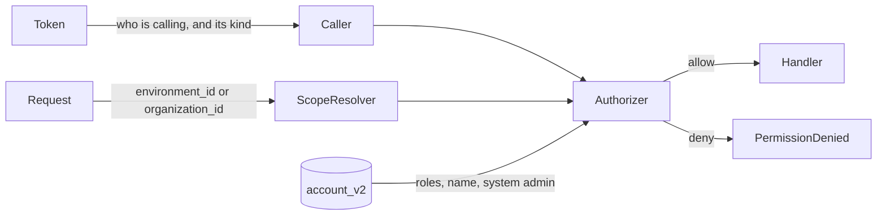
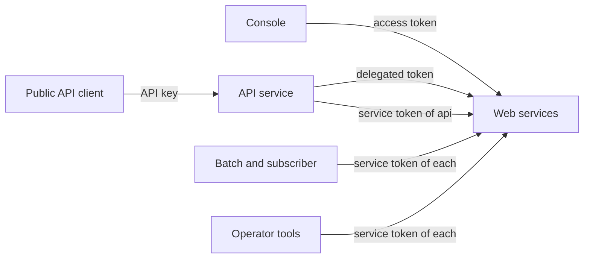
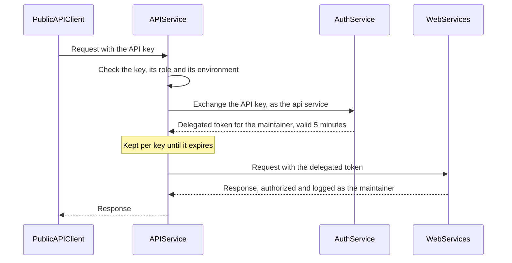
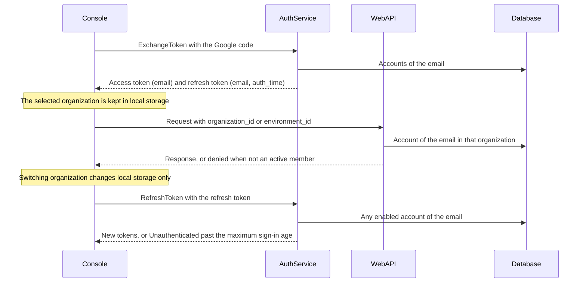

# Slim Access Token

This RFC reduces the console access token to the caller's identity. Roles,
system admin status, the display name and the organization are resolved on
the server for each request. Services and public API requests, which share
one token with users today, get their own credentials.

- Status: Draft
- Authors: Alessandro Yuichi Okimoto
- Related: RFC 0049 (centralized authorization, #3006), PR #3015 (authorization engine)

## 1. Background

The console signs in with Google and receives two JWTs signed with the same
key: an access token (10 minutes by default) and a refresh token (7 days by
default). The access token carries more than the caller's identity:

| Claim | Read by | Problem |
| --- | --- | --- |
| `email` | Every authorization check | The only identity. There is no `sub`. |
| `organization_id` | No backend code; only the dashboard's organization picker | `RefreshToken` writes the first organization with an enabled account, not the one the user selected, so the claim can name a different organization from the one in use. |
| `name` | `pkg/role`, for the editor in audit logs | Names are stored per account. The token carries the name from the organization chosen at sign-in, which may not be the one being edited. |
| `is_system_admin` | `pkg/role` and a few handlers | An authorization decision fixed for the lifetime of the token. Its derivation also looks wrong (see below). |
| `is_service_token` | `pkg/role` and a few handlers | A privilege flag inside the same token type users get. |

An account is one row of `account_v2`, keyed by `(email, organization_id)`,
so one email may hold accounts in several organizations. Anything in the
token that depends on the organization is therefore either a guess or has to
be reissued on every switch. The backend already ignores the claim: every
request names its organization or environment, and the account is looked up
for that request.

Three further problems were found while reviewing the token:

- **System admin derivation.** `getMyOrganizations` checks for a system
  admin organization before it leaves out disabled accounts, and sign-in then
  accepts an enabled account in any organization. A user whose system admin
  account is disabled but who has an enabled account elsewhere appears to
  receive `is_system_admin: true`. This was found by reading the code and has
  not been reproduced.
- **Service token.** `hack/generate-service-token` issues an access token
  valid for 100 years with both flags set. It has no identifier, so
  cancelling one means rotating the signing key, which signs out every user.
  One token is shared by the web, API, batch and subscriber services, the
  batch CronJobs and the operator tools, so a leak cannot be traced to a
  holder and replacing it touches all of them. Every internal call uses it,
  including the calls a service makes while handling a user's request.
- **Public API relay.** The API service checks the API key, then calls the
  web services with the shared service token and three metadata fields: the
  obfuscated key, the maintainer's email and the key name. The web services
  accept those fields on any service token and record the maintainer as the
  editor, so every holder of the service token can attribute a change to any
  user who has the role for it. The key's own role and environment are
  checked by the API service only.
- **Session lifetime.** `SwitchOrganization` accepts an access token and
  returns a new refresh token, so an access token that leaks on its own can
  be turned into lasting access. Each refresh returns a refresh token valid
  for another 7 days and the previous one stays valid, so a stolen refresh
  token can be renewed for as long as the account is enabled.

RFC 0049 replaces `pkg/role` with one authorization engine. In PR #3015 its
caller is the email, a service flag and the relayed API key, and roles, the
name and system admin status are read from the database. This RFC is the
token side of that change.

## 2. Goals / Non-Goals

Goals

- The access token says who the caller is and nothing else.
- Service identities get their own token type. User tokens carry no
  privilege flags.
- Each service has its own token, which names the service and can be
  cancelled without rotating the signing key.
- A public API request reaches the web services with one signed credential
  that names the API key and its maintainer. No request metadata is trusted
  for identity.
- A change of role, system admin status or name applies on the next request,
  not when the token expires.
- An access token that leaks on its own stops working when it expires.
- A stolen refresh token stops working after a maximum sign-in age.
- No new storage. Users sign in and switch organization as today, and sign
  in again once the maximum sign-in age has passed.
- A rolling upgrade and a rollback keep working at every step.

Non-Goals

- Server-side sessions: sign-out that revokes, immediate revocation and
  refresh token rotation (§7).
- Moving the refresh token out of local storage into an HttpOnly cookie (§7).
- A user table with a stable ID. `sub` is the email until one exists.
- Changing `exp` and `iat` to numeric dates (they are written as RFC 3339
  strings today), or a separate signing key for service tokens.
- The authorization rules themselves, which are RFC 0049. That includes
  limiting which RPCs each service may call: this RFC gives every service a
  name, and a service token keeps full access until RFC 0049 has rules for
  it.
- Network controls: which ports are reachable from outside the cluster, and
  mutual TLS between services (§7).

## 3. Design Overview



1. **The token identifies the caller.** It supplies the email of a user, the
   name of a service, or the API key and its maintainer.
2. **The request names the organization.** RFC 0049's Table 2 says which
   field of each RPC holds the environment or organization.
3. **The database supplies the rest.** Roles, the name and system admin
   status come from `account_v2` for that request.

Every request that reaches a web service carries exactly one of three
tokens. All are signed with the same key and verified by the same
interceptor on the gRPC server, so the REST gateway, direct gRPC and calls
from other services are checked in one place.



| Caller | Today | Proposed |
| --- | --- | --- |
| A user in the console | Access token with the organization, name and two flags | Access token with the identity only |
| A service acting on its own, including web services calling each other | One shared access token with both flags, valid for 100 years | A service token per service |
| The API service acting for an API key | The shared service token plus metadata naming the key and its maintainer | A delegated token issued for that key |

The access token changes as follows; the other two are described in §4.

| Claim | Today | Proposed |
| --- | --- | --- |
| `iss`, `aud`, `exp`, `iat` | yes | yes |
| `sub` | no | the email |
| `email` | yes | yes |
| `token_use` | `access` | `access` |
| `organization_id` | yes | removed |
| `name` | yes | removed |
| `is_system_admin` | yes | removed |
| `is_service_token` | yes | removed; service tokens are their own type |

## 4. Design Details

### Access token

```go
type AccessToken struct {
	Issuer   string    `json:"iss"`
	Subject  string    `json:"sub"`
	Audience string    `json:"aud"`
	Expiry   time.Time `json:"exp"`
	IssuedAt time.Time `json:"iat"`
	Email    string    `json:"email"`
	TokenUse string    `json:"token_use"`
}
```

`sub` identifies the person. It is the email today and becomes a stable user
ID if a user table is added. `email` stays because verifiers of the previous
version require it and handlers read it. There is no `jti`: nothing stores or
looks up user tokens.

### Service token

```go
type ServiceToken struct {
	Issuer   string    `json:"iss"`
	Subject  string    `json:"sub"`
	Audience string    `json:"aud"`
	Expiry   time.Time `json:"exp"`
	IssuedAt time.Time `json:"iat"`
	Email    string    `json:"email,omitempty"`
	ID       string    `json:"jti"`
	TokenUse string    `json:"token_use"` // "service"
}
```

- `sub` names the service the token was issued to: `web`, `api`, `batch`,
  `subscriber`, or a name chosen for an operator tool.
  `hack/generate-service-token` gains a `--service` flag for it.
- `email` is what `--email` sets today. It stays the editor in audit logs,
  so existing entries and the way they are shown do not change.
- **One token per service.** Each Helm chart already reads its own
  `serviceToken.secret`, so a deployment gives each chart a different Secret.
  The Docker Compose and development setups generate one file per service. A
  CronJob uses the token of its chart.
- **Cancelling a token.** `jti` identifies one token. A server option lists
  the IDs that are no longer accepted, and the verifier rejects them. A
  leaked token is cancelled by adding its ID and issuing a new token to that
  one service; users stay signed in and the other services are not touched.
- **Lifetime.** The generator gains a `--ttl` flag. The default does not
  change at first, so no deployment is broken by an unexpected expiry. A
  service reads its token at startup, so rotating it means replacing the
  Secret and restarting. The default is lowered to one year at the end of
  the rollout (§6), after a service warns when its own token is close to
  expiry. An operator can set a shorter lifetime with `--ttl`.
- **Access.** A service token keeps the full access it has today. Naming the
  service is what allows RFC 0049 to later give each one only the RPCs it
  calls.
- The verifier dispatches on `token_use`. An access token that has both
  `is_system_admin` and `is_service_token` is a legacy service token and is
  treated as a service identity, whether its `token_use` is `access` (the
  current generator stamps it) or absent (older tokens). Otherwise the access
  token verifier rejects a service token, and the reverse, as the existing
  token kinds already do.
- While `pkg/role` exists, the auth interceptor presents a service token to
  it as an access token with both legacy flags set, so services that are not
  yet migrated to RFC 0049 behave as today.

### Delegated token

A public API request acts for the maintainer of its API key. Today the API
service says so in request metadata next to the shared service token. The
metadata is replaced by a token that the auth service signs for that key:

```go
type DelegatedToken struct {
	Issuer        string    `json:"iss"`
	Subject       string    `json:"sub"`   // the maintainer
	Audience      string    `json:"aud"`
	Expiry        time.Time `json:"exp"`
	IssuedAt      time.Time `json:"iat"`
	Email         string    `json:"email"` // the maintainer
	TokenUse      string    `json:"token_use"` // "delegated"
	APIKeyID      string    `json:"api_key_id"`
	APIKeyName    string    `json:"api_key_name"`
	APIKeyToken   string    `json:"api_key_token"` // obfuscated, as in audit logs
	APIKeyRole    string    `json:"api_key_role"`
	EnvironmentID string    `json:"environment_id"`
}
```



- **Issuing.** A new auth service RPC takes the API key and requires the
  `api` service token. It looks the key up and refuses a disabled key, a
  disabled environment and a key whose role is not a public API role. The
  signing key stays in the web deployment.
- **Caching.** The API service keeps the token per key until shortly before
  it expires, next to the API keys it already caches. That is about one
  extra call per key every 5 minutes.
- **Verifying.** The web interceptor builds the same caller that
  `Caller.Relayed` builds from the metadata in PR #3015: the maintainer,
  with the API key attached. The maintainer's account and role are still
  read from the database on every request, and the editor in audit logs is
  the same as today.
- **Environment.** The request must be for the token's environment, or for
  the organization that owns it. Today only the API service checks this.
  `api_key_role` is available to RFC 0049 when the API key role lists move
  into its Table 2.
- **Which calls use it.** The calls that send the metadata today: every
  write and a few reads. The other reads keep using the API service's own
  service token. Judging them as the maintainer would deny a key whose
  maintainer is no longer an active member, which is an authorization change
  for RFC 0049 to decide.

The access token carries no organization because a user can switch, and the
claim would be a guess. A delegated token differs: an API key belongs to one
environment, the token cannot be refreshed, and it lives 5 minutes, so the
claim is exact for as long as the token is valid. Disabling a key or changing
its role applies when the cached token expires.

Until the exchange exists, the metadata is accepted only from the `api`
service token (and from the legacy token while it is still accepted), not
from every service token.

### Refresh token

The refresh token loses `organization_id` and gains `auth_time`, the time of
the original sign-in. The request does not change: it carries only the
refresh token.

`RefreshToken` does not act on any organization, so it needs none. It
answers one question, whether this person may stay signed in:

1. Verify the refresh token and take the email.
2. Require at least one enabled account in any organization, as today.
3. Reject the token when `auth_time` is older than the maximum sign-in age.
   The console then sends the user to sign in again, as it does for any
   rejected refresh.
4. Return a new access token and a new refresh token with the same
   `auth_time`.

A refresh token without `auth_time`, issued before this change, is treated
as signed in at its own `iat`. The maximum sign-in age is a new option next
to `accessTokenTTL` and `refreshTokenTTL`.

### One claims type for every kind

The demo-creation token is already marked `token_use: "demo"`. What it still
has of its own is a Go type and a sign and a verify function, and the service
and delegated tokens would add two more sets. Once the access token is
slimmed, the kinds carry almost the same claims, so they share one type:

```go
type Claims struct {
	Issuer   string    `json:"iss"`
	Subject  string    `json:"sub"`
	Audience string    `json:"aud"`
	Expiry   time.Time `json:"exp"`
	IssuedAt time.Time `json:"iat"`
	Email    string    `json:"email,omitempty"`
	ID       string    `json:"jti,omitempty"`
	TokenUse string    `json:"token_use"`
}
```

One function signs and one verifies, each taking the kind. The verifier
checks the signature, issuer, audience and expiry for every kind, and then
the rule of that kind, so "a token of one kind does not verify as another"
is decided in one place:

| Kind | `token_use` | Required claims | Accepted by |
| --- | --- | --- | --- |
| access | `access`, or absent on a token issued before the claim existed | `email` | Every RPC except `CreateDemoOrganization` |
| service | `service`, or the legacy form described under Service token | `sub`, `jti` (not required in the legacy form) | The same RPCs, as a service identity |
| delegated | `delegated` | `email`, the API key claims, `environment_id` | The same RPCs, as the maintainer acting through the API key |
| demo | `demo` | `email` | `CreateDemoOrganization` only |

The demo token on the wire does not change, except that it also carries
`sub`. Demo tokens live 5 minutes, so no older form has to be accepted.

`demo` stays a kind of its own and is not replaced by an access token. It
proves something an access token does not: `ExchangeDemoToken` issues it
only after checking that the email has no organization to sign in to, that
is, no enabled account in an organization that is neither disabled nor
archived. `CreateDemoOrganization` does not repeat that check. If an access
token were accepted there, any existing user could create demo
organizations.

Three things keep their own shape:

- **Go types for handlers.** `AccessToken`, `ServiceToken`, `DelegatedToken`
  and `DemoCreationToken` remain distinct named types over `Claims`, so the
  compiler still rejects a demo token where an access token is expected. The
  structs in the sections above list the claims each kind carries.
- **The delegated token's extra claims.** Its type embeds `Claims` and adds
  the API key and environment claims.
- **The refresh token.** It omits `iss` and `aud` on purpose, for verifiers
  of earlier versions, and would become an opaque value with server-side
  sessions (§7).

The access token keeps its own struct, with the old claims, until they are
removed (§6, step 11), and moves to `Claims` then.

### Which organization a request is for

| Request | Organization comes from | Check |
| --- | --- | --- |
| Carries `environment_id` | The organization that owns the environment | The caller's account in that organization, and its role in the environment |
| Carries `organization_id` | The request | The caller's account in that organization |
| The caller's own data (`GetMyOrganizations`) | None | A verified caller |
| System admin only | None | An enabled account in a system admin organization |

The table describes a user. Three callers are treated differently, as today
and as RFC 0049 keeps them:

| Caller | Check |
| --- | --- |
| System admin | Reads need no account in the organization. Writes need one, like any user. |
| Service token | No account is looked up. The service has full access. |
| Delegated token | The maintainer's account in the organization, as for a user, and the request must be for the token's environment or the organization that owns it. |

A user may put any organization in a request, and it is accepted only where
the user has an enabled account, apart from system admin reads. A user whose
account is disabled in one organization and enabled in another keeps a valid
token and is rejected by the first organization's check, as today.



### Switching organization

The console already keeps the selected organization in local storage and
sends it with each request. Switching becomes: store the new organization,
then call `GetMe` for it. The console stops decoding the access token, and
the `SwitchOrganization` RPC is removed.

### System admin

System admin status is read by email from the caller's account in a system
admin organization, and that account must be enabled. PR #3015 already does
this in the engine. Until every service uses the engine, `pkg/role` still
trusts the claim, so its derivation is fixed first: disabled accounts are
left out before the system admin check.

### What a stolen token gives

| | Today | Proposed |
| --- | --- | --- |
| Access token leaks on its own | Every organization of the user; can be traded for a refresh token through `SwitchOrganization` | Every organization of the user, until it expires |
| Both tokens are stolen | Every organization of the user, renewable without limit | Every organization of the user, until the maximum sign-in age |
| Role or system admin status is removed | Applies when the token expires | Applies on the next request |
| A service token leaks | Full access for up to 100 years. The holder cannot be identified, and cancelling the token rotates the signing key, which signs out every user and replaces the token everywhere. | Full access until its ID is cancelled or it expires. The token names its service, and only that service gets a new one. |
| A service token is used to name a user as the editor | Any holder can, through the relay metadata | No holder can. A delegated token is issued only for a valid API key and names that key's maintainer. |

A leaked service token still gives full access until it is cancelled. What
narrows that is outside this RFC: rules per service in RFC 0049, and the
network controls in §7.

## 5. Alternatives Considered

- **`sub` as `organization_id:email`.** It matches the `account_v2` key, but
  a system admin viewing an organization has no account there, the subject
  would change on every switch, and every reader would have to parse it.
- **An enforced `organization_id` claim.** The server would reject a request
  for any other organization. It helps only when the access token leaks on
  its own, and then narrows a few minutes of access from every organization
  to one. When the browser's storage is stolen the refresh token is stolen
  with it and can switch organization, unless switching requires signing in
  again, which costs every user who works in several organizations.
- **Server-side sessions now.** They add revocation, but also a table,
  rotation logic and a two-release rollout. The maximum sign-in age bounds
  the same theft without storage, and sessions can follow without changing
  the claims (§7).
- **A `typ` header instead of `token_use`.** `typ: at+jwt` is the standard
  marker for access tokens. `token_use` is as safe, since both are signed,
  and was introduced recently with its own compatibility handling. Nothing
  outside our verifier reads these tokens, so replacing it has no benefit
  today.
- **Checking tokens only at the gateway.** The REST gateway would
  authenticate, and the gRPC services behind it would trust every call. The
  gateway is not the only way in: the public listener also routes the
  service paths straight to the services, which the tests, the operator
  tools and the batch CronJobs use, and the charts do not limit the service
  ports to Envoy. One routing mistake would expose an administrative API
  with no check. The check stays on the gRPC server, where every route
  passes through it.
- **Signing the delegated token in the API service.** It saves the exchange
  call, but the signing key would have to be mounted in the API service,
  which faces the internet. Today only the web deployment holds it.
- **Forwarding the API key to the web services.** They could look the key up
  themselves, with no new token. The long-lived key would then travel to
  every service and its logs, where it is deliberately obfuscated today.
- **Keeping the relay metadata.** Limiting it to the `api` service token is
  the interim step of this RFC. On its own it leaves the identity of the
  user in unsigned request metadata, and the web services unable to check
  the key's environment.

## 6. Rollout Plan

Old claims are still written until no running version reads them, and a new
form is accepted one release before anything sends it.

Split the user and service tokens:

1. **Fix the system admin derivation.** Independent of everything else.
2. **Read both forms.** The signer adds `sub` and `auth_time`. The verifier
   accepts tokens with or without them, and service tokens in the new and
   the legacy form, and rejects the service token IDs listed as cancelled.
   `RefreshToken` enforces the maximum sign-in age. The service and demo
   tokens use the shared claims type, and every kind is signed and verified
   through one path.
3. **Console.** Stop decoding the token and stop calling
   `SwitchOrganization`. Mark the RPC deprecated.
4. **Remove `SwitchOrganization`** one release after step 3, so a cached
   console does not call a missing RPC.

Authorize in one place:

5. **Build the caller from the token** in RFC 0049's interceptor on the gRPC
   server: an access token gives the email, a service token gives the
   service name.

Give each service its own token:

6. **Issue one token per service** once the release after step 2 is
   deployed. The release before step 2 rejects the new type; waiting one
   release means a rollback lands on a version that accepts it. The legacy
   token stays valid, and putting it back is the way to roll back further.
7. **Accept the relay metadata from `api` only.** The legacy token may still
   relay until it is dropped.

Replace the relay metadata:

8. **Accept delegated tokens.** The auth service gains the exchange RPC and
   the web services verify delegated tokens. The API service's Envoy gets a
   route to the auth service. Nothing sends the token yet.
9. **Send delegated tokens** from the API service, one release later. A
   rollback of the API service returns to the metadata, which is still
   accepted.
10. **Stop reading the relay metadata** one release after step 9.

Clean up:

11. **Stop writing the old claims** (`organization_id`, `name`,
    `is_system_admin`, `is_service_token`) in the release after the one that
    deletes `pkg/role`, so a rollback target does not need them. The access
    token then moves to the shared claims type.
12. **Drop the legacy service token** in a later release, announced in the
    release notes.
13. **Shorten the service token.** Services warn when their own token is
    close to expiry, the rotation steps are documented, and the generator's
    default lifetime is lowered to one year. Tokens already issued keep
    their expiry.

## 7. Future Work

- **Server-side sessions.** A session table in the existing database gives
  sign-out and immediate revocation, and refresh token rotation with reuse
  detection.
- **HttpOnly cookie for the refresh token**, so a script on the page cannot
  read it. Nothing in the backend sets cookies today.
- **Rules per service.** With a name in every service token, RFC 0049 can
  list the RPCs each service may call instead of giving all of them full
  access.
- **Close the public service routes.** The public listener routes
  `/bucketeer.<package>.<Service>` paths straight to the services. Once the
  tests, operator tools and CronJobs use the REST gateway or the internal
  port, those routes can be removed, and a service token can be refused on
  the public listener.
- **Restrict the service ports.** The Go servers listen on every interface
  and the charts define no NetworkPolicy, so nothing in the charts stops
  another pod from reaching them without passing Envoy.
- **Mutual TLS between services.** TLS authenticates only the server today:
  every pod mounts the same certificate, and the Go clients present none. A
  private CA with one certificate per workload would identify the calling
  service at the connection, and could then replace the service token for
  calls inside the cluster.
- **Kubernetes service account tokens** as the service credential on
  Kubernetes. The kubelet issues one per workload and rotates it about every
  hour, so no long-lived token is stored. Docker Compose would keep the
  signed service token.

## 8. Open Questions

1. The default maximum sign-in age. The proposal is 30 days.
2. How a service token is marked. This RFC uses `token_use: "service"` like
   the other kinds; PR #3015 mentions a separate audience. One marker should
   be used for every kind.
3. Whether the service names are a fixed list in the code or free text. The
   relay rule and later the rules per service need at least `api` to be a
   known name.
4. The delegated token replaces `Caller.Relayed` in PR #3015, so it has to
   be agreed with RFC 0049. Whether the public API reads that do not relay
   today should also use it is a question for that RFC.
5. PR #2061 (password login) changes the same auth service and has not been
   checked against this design.
