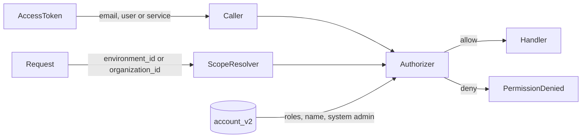
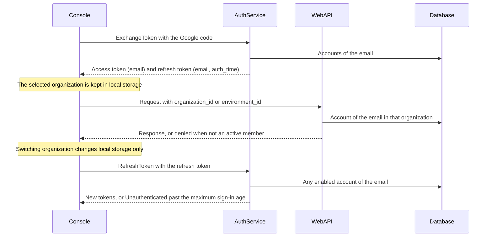

# Slim Access Token

This RFC reduces the console access token to the caller's identity. Roles,
system admin status, the display name and the organization are resolved on
the server for each request.

- Status: Draft
- Authors: Alessandro Yuichi Okimoto
- Related: RFC 0049 (centralized authorization, #3006), PR #3015 (authorization engine)

## 1. Background

The console signs in with Google and receives two JWTs signed with the same
key: an access token (10 minutes by default) and a refresh token (7 days by
default). The access token carries more than the caller's identity:

| Claim | Read by | Problem |
| --- | --- | --- |
| `email` | Every authorization check | The only identity. There is no `sub`. |
| `organization_id` | No backend code; only the dashboard's organization picker | `RefreshToken` writes the first organization with an enabled account, not the one the user selected, so the claim can name a different organization from the one in use. |
| `name` | `pkg/role`, for the editor in audit logs | Names are stored per account. The token carries the name from the organization chosen at sign-in, which may not be the one being edited. |
| `is_system_admin` | `pkg/role` and a few handlers | An authorization decision fixed for the lifetime of the token. Its derivation also looks wrong (see below). |
| `is_service_token` | `pkg/role` and a few handlers | A privilege flag inside the same token type users get. |

An account is one row of `account_v2`, keyed by `(email, organization_id)`,
so one email may hold accounts in several organizations. Anything in the
token that depends on the organization is therefore either a guess or has to
be reissued on every switch. The backend already ignores the claim: every
request names its organization or environment, and the account is looked up
for that request.

Three further problems were found while reviewing the token:

- **System admin derivation.** `getMyOrganizations` checks for a system
  admin organization before it leaves out disabled accounts, and sign-in then
  accepts an enabled account in any organization. A user whose system admin
  account is disabled but who has an enabled account elsewhere appears to
  receive `is_system_admin: true`. This was found by reading the code and has
  not been reproduced.
- **Service token.** `hack/generate-service-token` issues an access token
  valid for 100 years with both flags set. It has no identifier, so
  cancelling one means rotating the signing key, which signs out every user.
- **Session lifetime.** `SwitchOrganization` accepts an access token and
  returns a new refresh token, so an access token that leaks on its own can
  be turned into lasting access. Each refresh returns a refresh token valid
  for another 7 days and the previous one stays valid, so a stolen refresh
  token can be renewed for as long as the account is enabled.

RFC 0049 replaces `pkg/role` with one authorization engine. In PR #3015 its
caller is the email, a service flag and the relayed API key, and roles, the
name and system admin status are read from the database. This RFC is the
token side of that change.

## 2. Goals / Non-Goals

Goals

- The access token says who the caller is and nothing else.
- Service identities get their own token type. User tokens carry no
  privilege flags.
- A change of role, system admin status or name applies on the next request,
  not when the token expires.
- An access token that leaks on its own stops working when it expires.
- A stolen refresh token stops working after a maximum sign-in age.
- No new storage. Users sign in and switch organization as today, and sign
  in again once the maximum sign-in age has passed.
- A rolling upgrade and a rollback keep working at every step.

Non-Goals

- Server-side sessions: sign-out that revokes, immediate revocation and
  refresh token rotation (§7).
- Moving the refresh token out of local storage into an HttpOnly cookie (§7).
- A user table with a stable ID. `sub` is the email until one exists.
- Changing `exp` and `iat` to numeric dates (they are written as RFC 3339
  strings today), or a separate signing key for service tokens.
- The authorization rules themselves, which are RFC 0049.

## 3. Design Overview



1. **The token identifies the caller.** It supplies the email and whether
   the caller is a user or a service.
2. **The request names the organization.** RFC 0049's Table 2 says which
   field of each RPC holds the environment or organization.
3. **The database supplies the rest.** Roles, the name and system admin
   status come from `account_v2` for that request.

| Claim | Today | Proposed |
| --- | --- | --- |
| `iss`, `aud`, `exp`, `iat` | yes | yes |
| `sub` | no | the email |
| `email` | yes | yes |
| `token_use` | `access` | `access` |
| `organization_id` | yes | removed |
| `name` | yes | removed |
| `is_system_admin` | yes | removed |
| `is_service_token` | yes | removed; service tokens are their own type |

## 4. Design Details

### Access token

```go
type AccessToken struct {
	Issuer   string    `json:"iss"`
	Subject  string    `json:"sub"`
	Audience string    `json:"aud"`
	Expiry   time.Time `json:"exp"`
	IssuedAt time.Time `json:"iat"`
	Email    string    `json:"email"`
	TokenUse string    `json:"token_use"`
}
```

`sub` identifies the person. It is the email today and becomes a stable user
ID if a user table is added. `email` stays because verifiers of the previous
version require it and handlers read it. There is no `jti`: nothing stores or
looks up user tokens.

### Service token

```go
type ServiceToken struct {
	Issuer   string    `json:"iss"`
	Subject  string    `json:"sub"`
	Audience string    `json:"aud"`
	Expiry   time.Time `json:"exp"`
	IssuedAt time.Time `json:"iat"`
	ID       string    `json:"jti"`
	TokenUse string    `json:"token_use"` // "service"
}
```

- `sub` is the value `--email` sets today, so the editor in audit logs does
  not change.
- `jti` lets one long-lived token be told apart in logs and denied later
  without rotating the signing key. Nothing reads it yet.
- `hack/generate-service-token` emits this type and gains a `--ttl` flag. The
  default lifetime does not change, so no deployment is broken by an
  unexpected expiry.
- The verifier dispatches on `token_use`. A token without `token_use` that
  has both `is_system_admin` and `is_service_token` is accepted as a legacy
  service token. The access token verifier rejects a service token, and the
  reverse, as the existing token kinds already do.
- While `pkg/role` exists, the auth interceptor presents a service token to
  it as an access token with both legacy flags set, so services that are not
  yet migrated to RFC 0049 behave as today.

### Refresh token

The refresh token loses `organization_id` and gains `auth_time`, the time of
the original sign-in. The request does not change: it carries only the
refresh token.

`RefreshToken` does not act on any organization, so it needs none. It
answers one question, whether this person may stay signed in:

1. Verify the refresh token and take the email.
2. Require at least one enabled account in any organization, as today.
3. Reject the token when `auth_time` is older than the maximum sign-in age.
   The console then sends the user to sign in again, as it does for any
   rejected refresh.
4. Return a new access token and a new refresh token with the same
   `auth_time`.

A refresh token without `auth_time`, issued before this change, is treated
as signed in at its own `iat`. The maximum sign-in age is a new option next
to `accessTokenTTL` and `refreshTokenTTL`.

### Which organization a request is for

| Request | Organization comes from | Check |
| --- | --- | --- |
| Carries `environment_id` | The organization that owns the environment | The caller's account in that organization, and its role in the environment |
| Carries `organization_id` | The request | The caller's account in that organization |
| The caller's own data (`GetMyOrganizations`) | None | A verified caller |
| System admin only | None | An enabled account in a system admin organization |

A caller may put any organization in a request, and it is accepted only
where the caller has an enabled account. A user whose account is disabled in
one organization and enabled in another keeps a valid token and is rejected
by the first organization's check, as today.



### Switching organization

The console already keeps the selected organization in local storage and
sends it with each request. Switching becomes: store the new organization,
then call `GetMe` for it. The console stops decoding the access token, and
the `SwitchOrganization` RPC is removed.

### System admin

System admin status is read by email from the caller's account in a system
admin organization, and that account must be enabled. PR #3015 already does
this in the engine. Until every service uses the engine, `pkg/role` still
trusts the claim, so its derivation is fixed first: disabled accounts are
left out before the system admin check.

### What a stolen token gives

| | Today | Proposed |
| --- | --- | --- |
| Access token leaks on its own | Every organization of the user; can be traded for a refresh token through `SwitchOrganization` | Every organization of the user, until it expires |
| Both tokens are stolen | Every organization of the user, renewable without limit | Every organization of the user, until the maximum sign-in age |
| Role or system admin status is removed | Applies when the token expires | Applies on the next request |

## 5. Alternatives Considered

- **`sub` as `organization_id:email`.** It matches the `account_v2` key, but
  a system admin viewing an organization has no account there, the subject
  would change on every switch, and every reader would have to parse it.
- **An enforced `organization_id` claim.** The server would reject a request
  for any other organization. It helps only when the access token leaks on
  its own, and then narrows a few minutes of access from every organization
  to one. When the browser's storage is stolen the refresh token is stolen
  with it and can switch organization, unless switching requires signing in
  again, which costs every user who works in several organizations.
- **Server-side sessions now.** They add revocation, but also a table,
  rotation logic and a two-release rollout. The maximum sign-in age bounds
  the same theft without storage, and sessions can follow without changing
  the claims (§7).
- **A `typ` header instead of `token_use`.** `typ: at+jwt` is the standard
  marker for access tokens. `token_use` is as safe, since both are signed,
  and was introduced recently with its own compatibility handling. Nothing
  outside our verifier reads these tokens, so replacing it has no benefit
  today.

## 6. Rollout Plan

Old claims are still written until no running version reads them.

1. **Fix the system admin derivation.** Independent of everything else.
2. **Read both forms.** The signer adds `sub` and `auth_time`. The verifier
   accepts tokens with or without them, and service tokens in the new and
   the legacy form. `RefreshToken` enforces the maximum sign-in age.
3. **Console.** Stop decoding the token and stop calling
   `SwitchOrganization`. Mark the RPC deprecated.
4. **Regenerate the service token** once every pod runs the release of step
   2. A pod on the previous version rejects the new type.
5. **Remove `SwitchOrganization`** one release after step 3, so a cached
   console does not call a missing RPC.
6. **Build the caller from the token** in RFC 0049's interceptor: a user
   token gives the email, a service token gives its subject and the service
   flag.
7. **Stop writing the old claims** (`organization_id`, `name`,
   `is_system_admin`, `is_service_token`) in the release after the one that
   deletes `pkg/role`, so a rollback target does not need them.
8. **Drop the legacy service token** in a later release, announced in the
   release notes.

## 7. Future Work

- **Server-side sessions.** A session table in the existing database gives
  sign-out and immediate revocation, and refresh token rotation with reuse
  detection.
- **HttpOnly cookie for the refresh token**, so a script on the page cannot
  read it. Nothing in the backend sets cookies today.

## 8. Open Questions

1. The default maximum sign-in age. The proposal is 30 days.
2. How a service token is marked. This RFC uses `token_use: "service"` like
   the other kinds; PR #3015 mentions a separate audience. One marker should
   be used for every kind.
3. Whether to add a deny list of service token IDs now, or keep `jti` unused
   until it is needed.
4. PR #2061 (password login) changes the same auth service and has not been
   checked against this design.
